<p align="center">
  
</p>

<h1 align="center">Contrail</h1>

<p align="center">
  <b>A fast, smooth live air-traffic map you can run on your own server.</b>
</p>

<p align="center">
  <a href="https://contrail.maciejzielinski.dev">Try it live</a> · <a href="https://status.maciejzielinski.dev">Status</a> · <a href="https://maciejzielinski.dev">Portfolio</a>
</p>

<p align="center">
  <a href="https://github.com/MaciejZiel/contrail/actions/workflows/ci.yml"></a>
  <a href="LICENSE"></a>
  
  
  
</p>

<p align="center">
  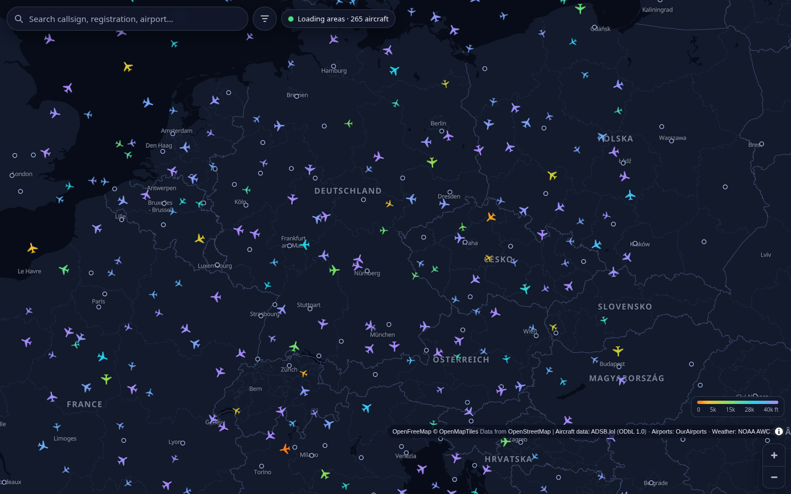
</p>

<p align="center"><sub>This screenshot and the demo-mode gallery below use the built-in demo mode: the aircraft are synthetic. With the real feed the map looks the same.</sub></p>

## Features

- **Smooth live map.** Every aircraft is extrapolated each frame from its track and ground speed and eased towards each new fix, so nothing jumps and nothing fades with age. How old the data is shows in a small status chip, never by hiding aircraft. About 60 fps with 15,000 aircraft on an integrated GPU.
- **Flight panel.** Photo, callsign, airline, type, registration, route (from and to), live altitude, speed, vertical rate, squawk, altitude / speed / vertical-rate history, the whole track coloured by altitude, the rest of the route as a dashed line, distance flown and remaining, and an arrival estimate (clearly labelled as an estimate).
- **Recent tracks for every aircraft.** Turn on 30 or 60 minute tracks and each aircraft in view gets a line behind it, coloured by its altitude. They are drawn from the server's own record of what it has seen, so they cost no extra request to the ADS-B source; they start when the server first saw the aircraft, not at take-off, and appear from zoom 6 (below that there are too many aircraft to read).
- **Search** by callsign, registration, ICAO24, airport or airline, with a keyboard-friendly dropdown.
- **Airport view.** Click an airport on the map for decoded METAR and TAF, the airport's type, runways with length and surface, radio frequencies and links (OurAirports data), and counts and lists of arriving, departing and parked aircraft within 10 nm. Those are inferred from position and vertical rate, or from a route the server already knows; it is not a timetable.
- **Filters** for altitude, airline, callsign prefix, aircraft type (ICAO codes, several at once, `A32*` for a family; type a name to find the code ) and ground traffic; everything, including the view, the selection, the filters and the track length, lives in the URL so any state can be shared.
- **Phone-first layout**: a bottom sheet with three snap points on small screens, a side panel on desktop.
- **Demo mode** with synthetic traffic, used by CI and for offline screenshots.

## Screenshots

Self-hosted on a home server: [contrail.maciejzielinski.dev](https://contrail.maciejzielinski.dev) runs the real ADSB.lol feed, so coverage and freshness are limited by the public API (see below) and the status chip says how old the data is. These screenshots come from the live site:

<p align="center">
  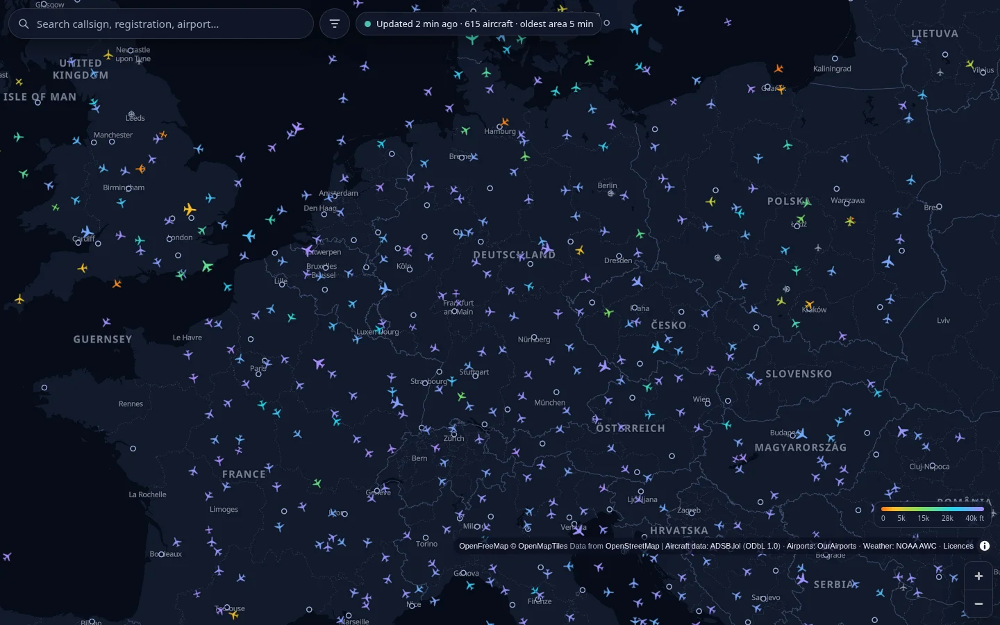
  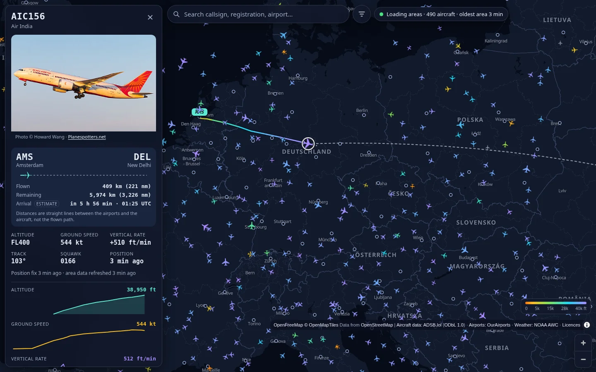
</p>

<p align="center">
  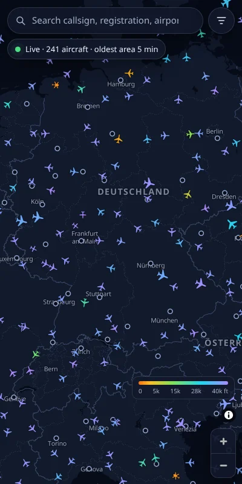
  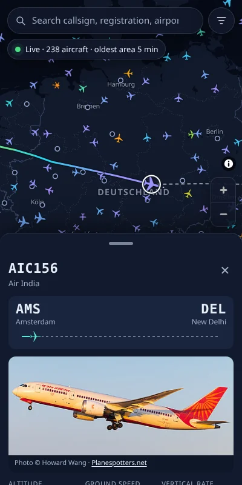
</p>

<p align="center"><sub>Aircraft photo: © Howard Wang, via <a href="https://www.planespotters.net">Planespotters.net</a>.</sub></p>

Demo mode:

<p align="center">
  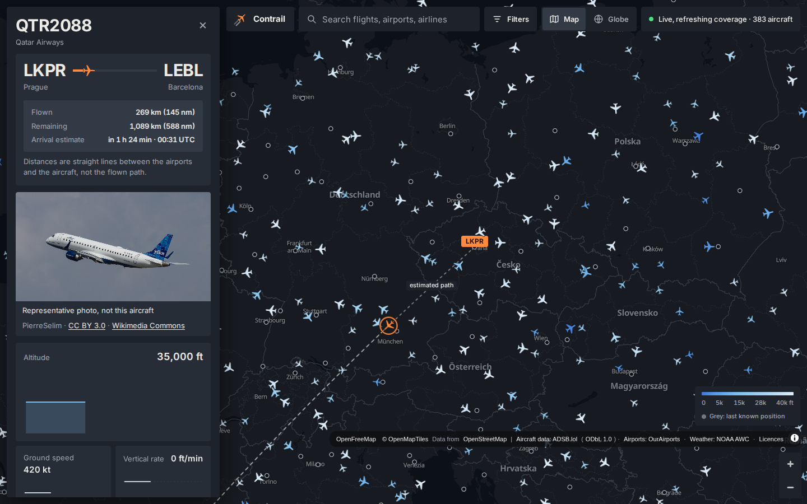
  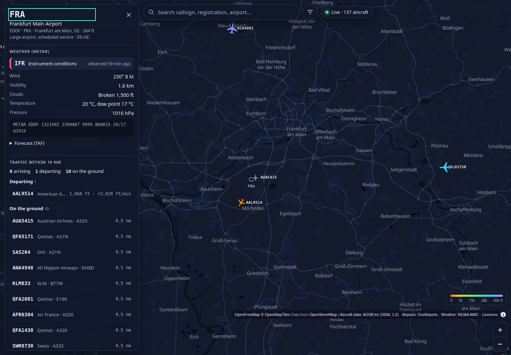
  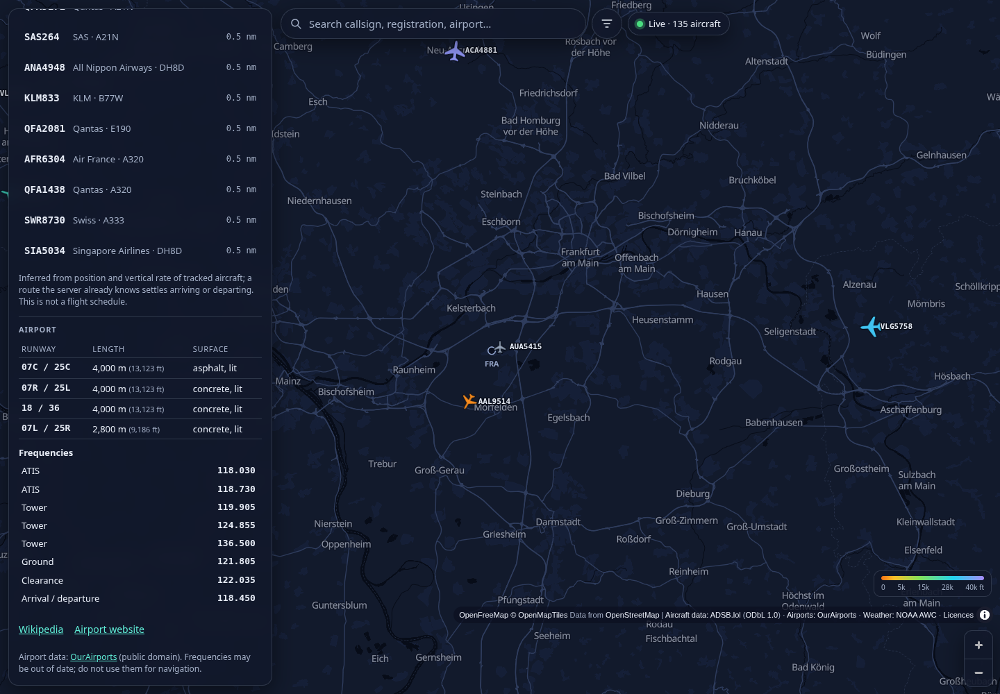
  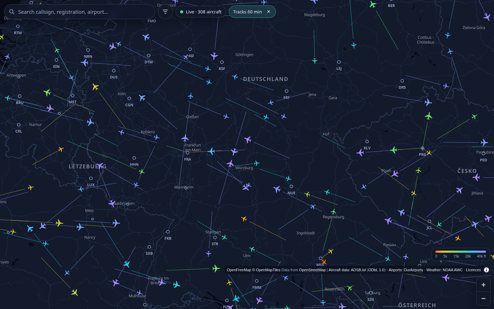
  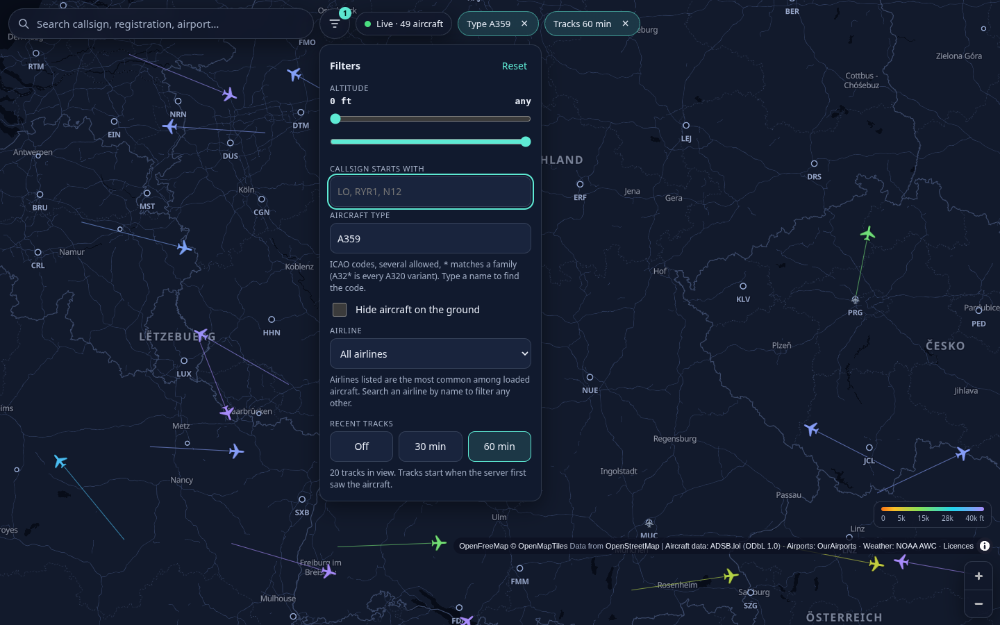
  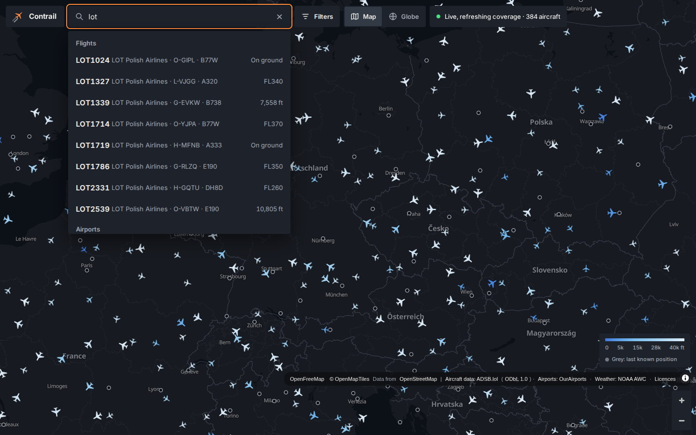
  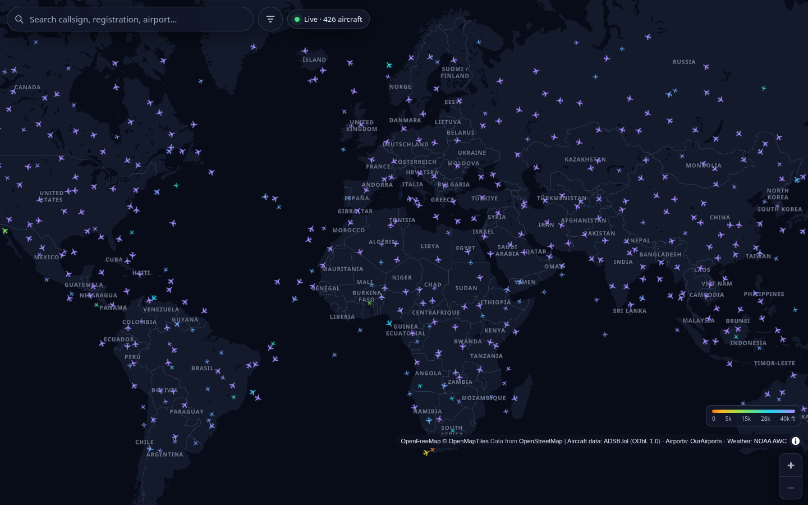
</p>

<p align="center">
  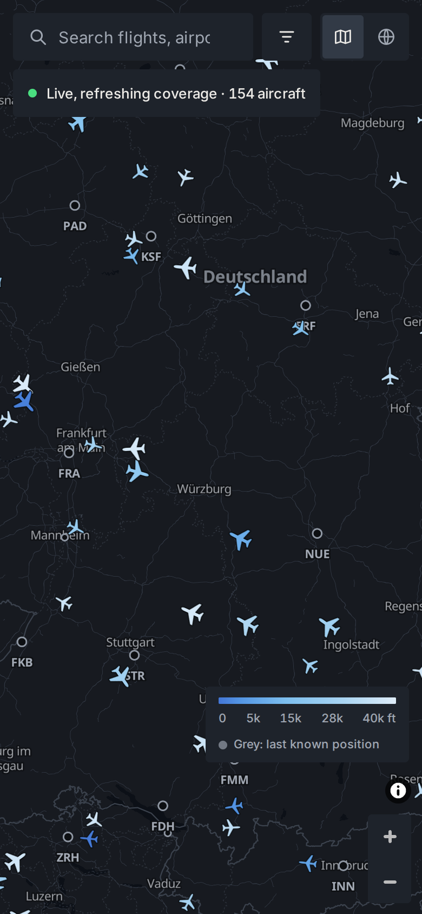
  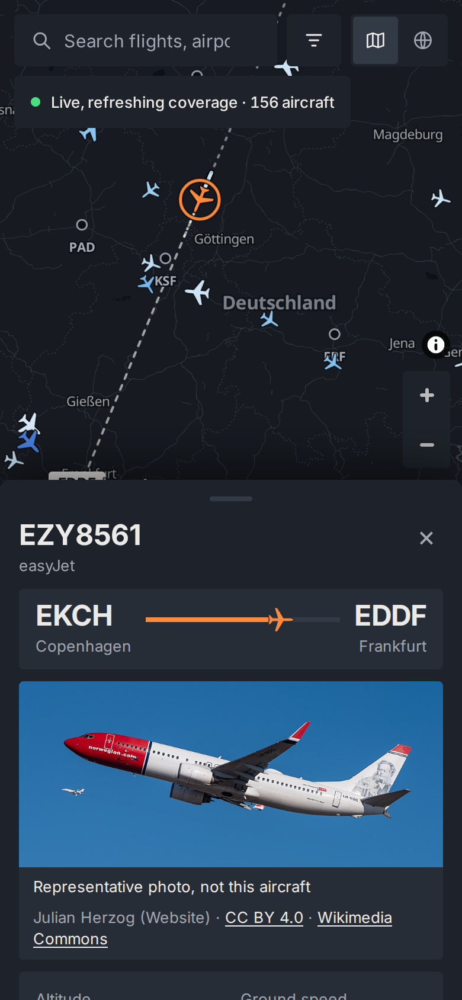
  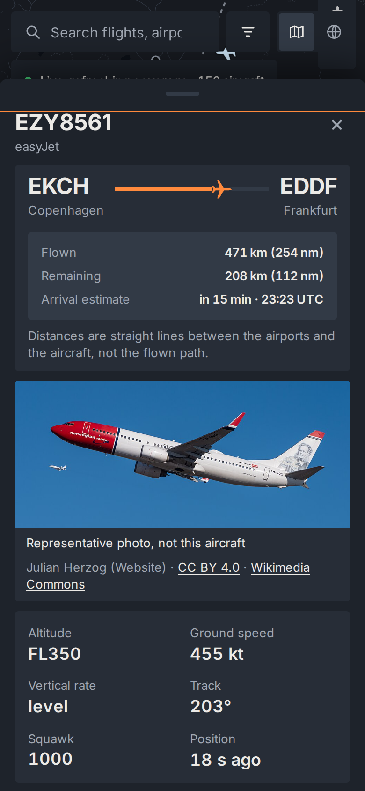
  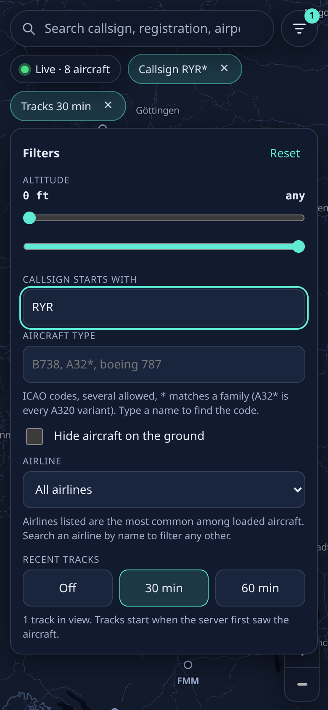
</p>

## Quick start


Docker is for local development and CI only.

```bash
docker compose up --build        # demo traffic on http://localhost:18080
DEMO_MODE=0 docker compose up    # the real ADSB.lol feed (read the limits above)
```

Without Docker:

```bash
cd server && python -m venv .venv && . .venv/bin/activate && pip install -r requirements-dev.txt
DEMO_MODE=1 python -m flightmap                  # API on 127.0.0.1:8000
cd ../web && npm ci && npm run dev               # app on http://localhost:5173 (proxies /api)
```

### Configuration (environment variables)

| Variable | Default | Meaning |
|---|---|---|
| `HOST`, `PORT` | `127.0.0.1`, `8000` | where the API listens |
| `BASE_PATH` | empty | URL prefix if the reverse proxy does not strip it |
| `DEMO_MODE` | `0` | synthetic traffic and weather, no network |
| `UPSTREAM_BUDGET_RPS` | `0.15` | upper bound for requests per second to ADSB.lol (adapts downwards on 429) |
| `PREFETCH_REGIONS` | Europe, US East, US West, eleven hubs | background coverage plan `name:south,north,west,east:priority:interval_s;...` (`all` for the world, `off` disables) |
| `PREFETCH_ALWAYS` | `1` | prefetch even with no viewers (`0`: only for 15 minutes after the last viewer) |
| `MAX_TILE_AGE_S` | `900` | tiles older than this are not served; the map dims data older than two thirds of it |
| `DATA_DIR` | `./data` | SQLite trail checkpoints |
| `GZIP` | `1` | compress responses (turn off behind nginx) |
| `USER_AGENT_CONTACT` | repo URL | included in the User-Agent sent to upstream services; set your own |
| `STATIC_DIR` | empty | serve a built web app from the API process (dev, Docker) |

The API is documented in [server/README.md](server/README.md).

## Architecture


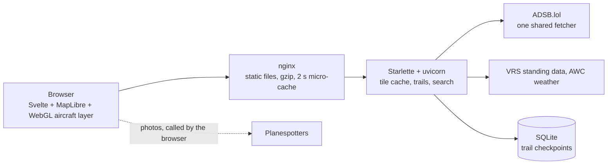

- The server keeps a **tile cache** (5 degree tiles) that is filled on demand, shared by every viewer, and refreshed under a global request budget. Responses are a **compact binary format** (32 bytes per aircraft; 15,000 aircraft are about 300 KB gzipped, against 3.4 MB of JSON in the previous version), with a strong ETag so unchanged areas cost a 304.
- At low zoom the server returns one representative aircraft per screen-sized grid cell, so weak devices never draw tens of thousands of icons. Full density from zoom 7.
- Recent tracks for all aircraft in view come from `/api/v1/trails`, which reads the trail memory below for one box: at most 400 aircraft (nearest the centre), each thinned to 40 points, refreshed every 15 s while switched on. Measured with 5,000 trails of 30 minutes: 14 ms to select, about 95 KB gzipped for 400 aircraft, no extra memory (it reads the existing trails). No ADSB.lol request is involved (a test asserts that the request counter does not move).
- Trails are compact arrays: the last 15 minutes at full resolution, older points thinned (Douglas-Peucker on position and altitude). 5,000 aircraft with 6 hours of flight each use about 38 MB. A checkpoint to SQLite survives restarts.
- Each enrichment (route, photo, weather, aircraft identity) fails on its own and shows an honest message for that field only.
- Pure Python dependencies only (Starlette, uvicorn, anyio, h11, click, idna), no native wheels, so it runs on Python 3.12 to 3.14 including on aarch64 Termux.

## Data sources and limits


Read this before you rely on the map. The numbers below were measured while building it.

| Need | Source | Terms / notes |
|---|---|---|
| Aircraft positions | [ADSB.lol](https://adsb.lol) public API (`/v2/point`), community ADS-B receivers | Data is ODbL 1.0: it is credited in the UI. The `/api/v1` output re-publishes it, so it is offered under the same licence (`X-Data-License` header on every API response); the app has no bulk export. The API has no published rate limit ("dynamic, based on load"). |
| Route of a flight | VRS standing data (CC0), served by ADSB.lol | Scheduled route for the callsign; shown only if the aircraft plausibly is on it. |
| Airline and aircraft type names | VRS standing data (CC0) | Bundled. |
| Airports | OurAirports (public domain) | Bundled. |
| Weather | NOAA Aviation Weather Center METAR/TAF | US government data, rate limit respected. |
| Photos | Planespotters photo API, called by the visitor's browser | Their terms forbid proxying or storing; credit and link are always shown. Planespotters refuses some automated clients (a browser that identifies as HeadlessChrome gets no CORS headers); real browsers are not affected (verified on the live site). A blocked client makes one failed request, then the stored type photo or illustration is used without further console errors. |
| Fallback photos | 142 type photos from Wikimedia Commons, public domain / CC0 / CC BY only | Stored in `web/public/type-photos` with author and licence per image; labelled "representative photo, not this aircraft". |
| Basemap | OpenFreeMap vector tiles (OpenStreetMap data) | Free public instance, credited. |

**Upstream budgets.** Tiles, single-aircraft lookups, routes and weather each have their own request budget and their own thread, so search or weather traffic can never slow the map down: lookups 0.05 requests per second, routes 2 per second, weather 1.5 per second (NOAA allows 100 per minute). When a budget is empty the field says "busy" instead of calling upstream.

**Plain limits of the aircraft feed**

- The public ADSB.lol API answers a query for at most a 250 nautical mile circle, so the server works with 5 degree tiles and fetches **one request per tile**. From the machine this was developed on, **27 to 43 percent of requests were answered with HTTP 429** and the sustainable rate was roughly 0.15 to 0.2 requests per second.
- Consequence: a **cold start of a large region is slow**. In a real 15 minute run only 67 of the 79 Europe tiles had loaded, and tile data was 4 to 5 minutes old on median. Zoomed in on a city or country the picture is fresh within seconds; zoomed out over a continent it is a mosaic of areas of different age, dead-reckoned in between. The status chip says how old the oldest area is. It does not pretend otherwise.
- **Coverage is a plan, not a promise.** After the tiles somebody is looking at (always first, refreshed about every 10 s anywhere in the world), spare budget goes to a short list shared by weight: Europe 60 percent (target 5 minutes per tile), US East and West 30 percent (15 minutes), and eleven busy hubs (Dubai, Singapore, Hong Kong, Shanghai, Beijing, Tokyo, Delhi, Mumbai, Sao Paulo, Johannesburg, Sydney) 10 percent (30 minutes): under 200 of the 751 tiles that contain an airport. Everything else is fetched only on demand. Tiles that keep coming back empty (ocean, desert, polar) are looked at 20 to 60 times less often. At about 0.15 requests per second even this is more than one IP can keep fresh: the targets are an order and a rate, not a promise, and `/api/v1/status` reports the real median and oldest age per class.
- **Old data is dimmed, then hidden.** Aircraft whose area was last refreshed more than 10 minutes ago are drawn faded, and beyond 15 minutes they disappear (server and client agree on the cap, and the server frees the memory). The flight panel shows both the age of the aircraft's last position and of its area.
- The server is a polite client: one shared fetcher, a global budget (`UPSTREAM_BUDGET_RPS`, default 0.2), automatic back-off on 429, tiles that are usually empty (ocean, polar) are refreshed far less often, and the background plan is what it keeps warm.
- **OpenSky Network is not used.** Its terms require a written licence for any operational use of its REST API in a live service. **airplanes.live is not used** either: its terms allow personal, non-commercial use only and forbid re-publishing the data. adsbdb.com is not used because its route data may not be copied into other databases.
- The flight track is **our own record** of what the server has seen since it first looked at the aircraft. There is no permitted source for a complete trace from take-off, so a flight first seen mid-air gets a dashed, labelled "estimated path" from its origin airport.
- Arrival times are estimates (remaining great-circle distance divided by current ground speed). Airport arrivals and departures are inferred from aircraft behaviour (and from a route the server happens to have cached), not from schedules; the server never looks up routes for an airport page.
- A personal, non-commercial deployment is assumed throughout.

## Self-hosting on Termux


Contrail runs as plain processes on a small always-on server; Termux on an aarch64 Android device is one target (nothing here needs a native wheel). The public name is `contrail.maciejzielinski.dev`, reached through a tunnel with no open ports.

1. Install `python`, `nodejs` (24 LTS) and `nginx` from the Termux packages and clone this repository to `~/contrail`.
2. Run `deploy/termux/install.sh` by hand, on the first deploy and on every update. It needs the network: it creates the virtualenv, installs the six pure-Python requirements and builds the web app. Nothing is installed at boot.
3. Copy `deploy/termux/env.example` to `~/.config/contrail/env` and set `USER_AGENT_CONTACT`.
4. Supervise the API like the other services on the host: link `deploy/termux/run-contrail.sh` to `~/services/run-contrail.sh` (it restarts `start.sh` after 5 seconds) and start it from `~/.termux/boot/start-services`. `start.sh` only does `exec python -m flightmap` on `127.0.0.1:8100`.
5. nginx: include `deploy/termux/nginx-http.conf` at **http level** (it defines `proxy_cache_path`, the rate-limit zones and the client-address map, which are not allowed inside a server block) and `deploy/termux/nginx-server.conf` for the server block. Adjust the absolute paths in the includes if you cloned elsewhere, then run `nginx -t`. Point the tunnel at `127.0.0.1:8080`.
   - **Termux's `mime.types` has no `.mjs` entry**, so without help nginx serves the MapLibre worker as `text/plain` and the browser refuses it (blank map). `nginx-server.conf` includes `mime.types` and adds `types { text/javascript mjs; }`; if you use your own server block, add `text/javascript mjs;` to `$PREFIX/etc/nginx/mime.types` or an equivalent `types` block.
   - `limit_req_status 429` is set inside the Contrail server block only, so other sites on the same nginx keep their own rate-limit status.
   - `/api/` is limited to 10 requests per second and the endpoints that can cost an upstream request (search, weather, aircraft details and routes) to 1 per second, per `CF-Connecting-IP`.
   - Responses carry a content security policy and the usual security headers (`nginx-headers.conf`, which must match `CONTENT_SECURITY_POLICY` in `server/flightmap/app.py`; a test checks it). `index.html` is never cached, hashed assets and the version-named map worker are cached for a year.
   - `/api/` gets gzip and a 2 second micro-cache, so any number of viewers cost one backend call per two seconds.

The measurements in this README were taken on a development laptop, not on that hardware.

## Tech stack

| Layer | Used |
|---|---|
| Server | Python 3.12 to 3.14, Starlette, uvicorn, SQLite (trail checkpoints) |
| Web | Svelte 5, MapLibre GL, WebGL aircraft layer |
| Serving | nginx (static files, gzip, 2 s micro-cache) |
| Quality | unittest, ruff, pyright (strict), vitest, Playwright |

## Tests


- `server/`: `python -m unittest discover -s tests -t .`, `ruff check`, `ruff format --check`, `npx pyright` (strict). Tests include the real provider against a fixture upstream that serves synthetic data shaped exactly like ADSB.lol responses.
- `web/`: `npm run typecheck`, `npm test` (vitest), `npm run test:e2e` (Playwright against the real server and the built app, desktop and a Pixel 7 profile).
- `web/scripts/perf.mjs` measures frame times (`GPU=1`, `THROTTLE=6`); `web/scripts/screenshots.mjs` and `screenshots-features.mjs` regenerate the demo screenshots; `server/scripts/measure_trails.py` measures trail memory.
- CI (`.github/workflows/ci.yml`) runs all of it.

## Repository layout


```
server/flightmap/   API, tile cache, providers, trails, search (Python)
server/tests/       unit and integration tests, fixture upstream
server/scripts/     data builders (airports, airlines, type photos) and probes
web/src/            core (decoder, dead reckoning, poller), map (WebGL layer), panel, search, filters, ui
web/e2e/            Playwright tests
web/public/type-photos/   type gallery with manifest and attributions
deploy/termux/      start script, env example, nginx snippet, boot script
docs/design.md      the design this was built from, with amendments
```

## Licence and attribution


Code: MIT, see [LICENSE](LICENSE). Third-party components and data, including one line per type photo, are listed in [3rdparty_licenses.md](3rdparty_licenses.md); photo credits are in [web/public/type-photos/ATTRIBUTIONS.md](web/public/type-photos/ATTRIBUTIONS.md). Aircraft data: [ADSB.lol](https://adsb.lol) (ODbL 1.0). Map data: OpenStreetMap contributors via OpenFreeMap and OpenMapTiles. Weather: NOAA Aviation Weather Center. Photos: Planespotters.net photographers and Wikimedia Commons authors as credited next to each image.
